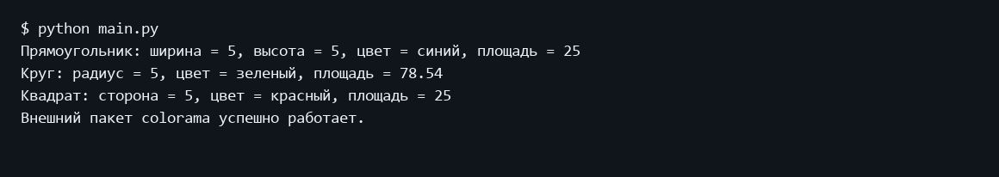
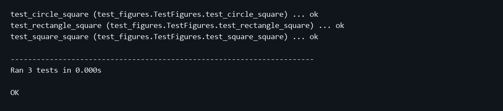

Министерство науки и высшего образования Российской Федерации
Московский государственный технический университет имени Н Э Баумана
Факультет Информатика и системы управления
Кафедра Системы обработки информации и управления

# Лабораторная работа 2
## Объектно ориентированные возможности языка Python

Дисциплина: Парадигмы и конструкции языков программирования
Выполнил: студент группы ИУ5-32Б Трефилов Д.И.
Москва 2026

## 1 Цель работы
Изучить классы, наследование, абстрактные методы, свойства и пакеты Python.

## 2 Постановка задачи
Реализовать пакет lab_python_oop с абстрактной геометрической фигурой, цветом, прямоугольником, кругом и квадратом. В main.py создать фигуры с параметром N = 5, вывести площади и вызвать внешний пакет colorama.

Источник задания: https://github.com/ugapanyuk/BKIT_2022/wiki/lab_python_oop
Список курса: https://github.com/ugapanyuk/courses_content/wiki/COURSE_PCPL_MAIN

## 3 Структура и логика программы
GeometricFigure задает абстрактный метод square. Rectangle и Circle реализуют вычисление площади, Square наследует Rectangle. FigureColor хранит цвет в свойстве. Методы класса возвращают название фигуры, __repr__ формирует строку с параметрами. Существующий код и отчет Word сохранены.

## 4 Порядок запуска
Команды выполняются из папки работы в подготовленном окружении.
```powershell
python -m pip install -r requirements.txt
python main.py
python -m unittest discover -s tests -v
```

## 5 Проверка программы
Три теста unittest проверяют площади прямоугольника 5 × 4, квадрата со стороной 5 и круга с радиусом 5. Для круга используется сравнение с допустимой погрешностью.

### Пример выполнения
```text
$ python main.py
Прямоугольник: ширина = 5, высота = 5, цвет = синий, площадь = 25
Круг: радиус = 5, цвет = зеленый, площадь = 78.54
Квадрат: сторона = 5, цвет = красный, площадь = 25
Внешний пакет colorama успешно работает.
```

### Экранная форма выполнения


### Модульные тесты
```text
test_circle_square (test_figures.TestFigures.test_circle_square) ... ok
test_rectangle_square (test_figures.TestFigures.test_rectangle_square) ... ok
test_square_square (test_figures.TestFigures.test_square_square) ... ok

----------------------------------------------------------------------
Ran 3 tests in 0.000s

OK
```



## 6 Выводы
Реализованы и проверены основные механизмы ООП и использование внешнего пакета colorama.

## Приложение Листинги программ

### lab_python_oop/circle.py
```python
import math

from lab_python_oop.geometric_figure import GeometricFigure
from lab_python_oop.figure_color import FigureColor


class Circle(GeometricFigure):

    FIGURE_TYPE = "Круг"

    def __init__(self, radius, color):
        self.radius = radius
        self.fc = FigureColor(color)

    def square(self):
        return math.pi * self.radius ** 2

    @classmethod
    def get_figure_type(cls):
        return cls.FIGURE_TYPE

    def __repr__(self):
        return "{}: радиус = {}, цвет = {}, площадь = {:.2f}".format(
            self.get_figure_type(),
            self.radius,
            self.fc.color,
            self.square()
        )
```

### lab_python_oop/figure_color.py
```python
class FigureColor:

    def __init__(self, color):
        self._color = color

    @property
    def color(self):
        return self._color

    @color.setter
    def color(self, value):
        self._color = value
```

### lab_python_oop/geometric_figure.py
```python
from abc import ABC, abstractmethod


class GeometricFigure(ABC):

    @abstractmethod
    def square(self):
        pass
```

### lab_python_oop/rectangle.py
```python
from lab_python_oop.geometric_figure import GeometricFigure
from lab_python_oop.figure_color import FigureColor


class Rectangle(GeometricFigure):

    FIGURE_TYPE = "Прямоугольник"

    def __init__(self, width, height, color):
        self.width = width
        self.height = height
        self.fc = FigureColor(color)

    def square(self):
        return self.width * self.height

    @classmethod
    def get_figure_type(cls):
        return cls.FIGURE_TYPE

    def __repr__(self):
        return "{}: ширина = {}, высота = {}, цвет = {}, площадь = {}".format(
            self.get_figure_type(),
            self.width,
            self.height,
            self.fc.color,
            self.square()
        )
```

### lab_python_oop/square.py
```python
from lab_python_oop.rectangle import Rectangle


class Square(Rectangle):

    FIGURE_TYPE = "Квадрат"

    def __init__(self, side, color):
        super().__init__(side, side, color)
        self.side = side

    def __repr__(self):
        return "{}: сторона = {}, цвет = {}, площадь = {}".format(
            self.get_figure_type(),
            self.side,
            self.fc.color,
            self.square()
        )
```

### main.py
```python
from colorama import Fore, Style, init

from lab_python_oop.rectangle import Rectangle
from lab_python_oop.circle import Circle
from lab_python_oop.square import Square


def main():
    init()

    n = 5

    rectangle = Rectangle(n, n, "синий")
    circle = Circle(n, "зеленый")
    square = Square(n, "красный")

    print(rectangle)
    print(circle)
    print(square)

    print(
        Fore.CYAN +
        "Внешний пакет colorama успешно работает."
        + Style.RESET_ALL
    )


if __name__ == "__main__":
    main()
```

### requirements.txt
```text
colorama==0.4.6
```

### tests/test_figures.py
```python
import unittest
import math

from lab_python_oop.rectangle import Rectangle
from lab_python_oop.circle import Circle
from lab_python_oop.square import Square


class TestFigures(unittest.TestCase):

    def test_rectangle_square(self):
        rectangle = Rectangle(5, 4, "синий")
        self.assertEqual(rectangle.square(), 20)

    def test_square_square(self):
        square = Square(5, "красный")
        self.assertEqual(square.square(), 25)

    def test_circle_square(self):
        circle = Circle(5, "зеленый")
        self.assertAlmostEqual(circle.square(), math.pi * 25)


if __name__ == "__main__":
    unittest.main()
```
