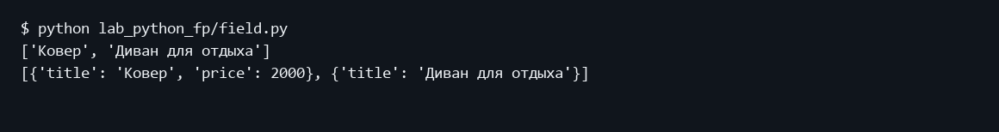
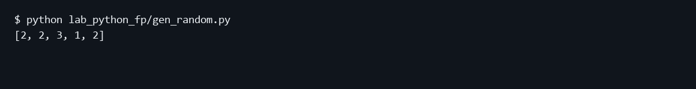
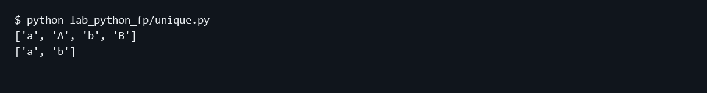
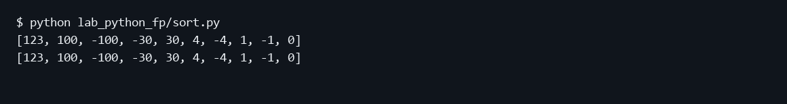
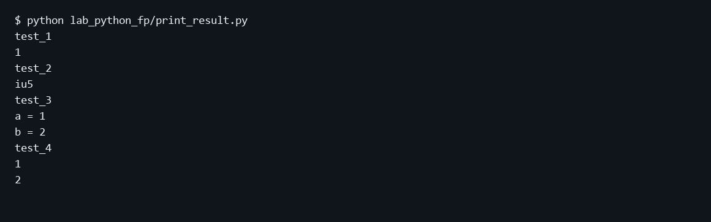
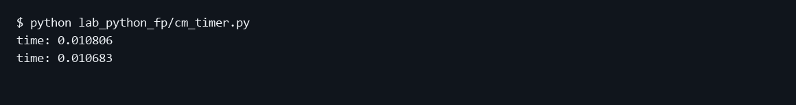
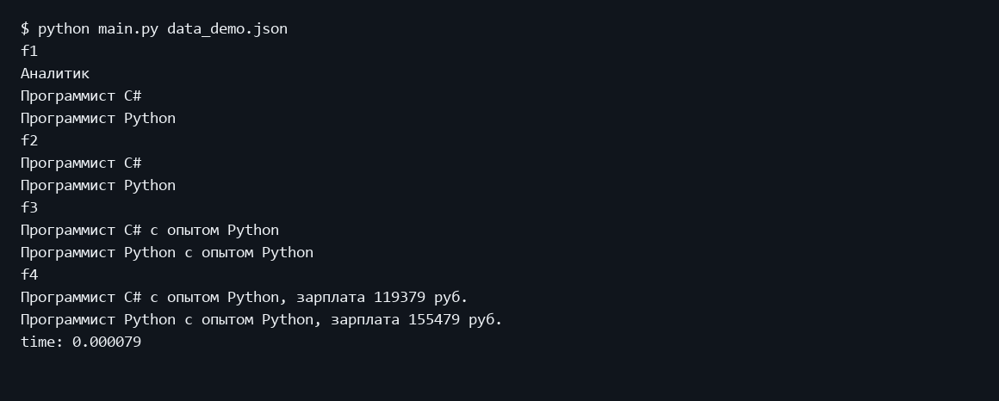
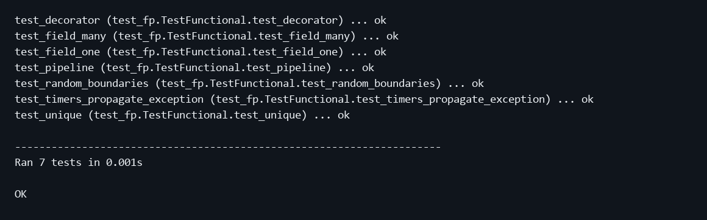

Министерство науки и высшего образования Российской Федерации
Московский государственный технический университет имени Н Э Баумана
Факультет Информатика и системы управления
Кафедра Системы обработки информации и управления

# Лабораторная работа 2
## Функциональные возможности языка Python

Дисциплина: Парадигмы и конструкции языков программирования
Выполнил: студент группы ИУ5-32Б Трефилов Д.И.
Москва 2026

## 1 Цель работы
Изучить генераторы, итераторы, функции высшего порядка, декораторы и контекстные менеджеры.

## 2 Постановка задачи
Выполнить все семь задач в пакете lab_python_fp. Каждый файл должен запускать пример самостоятельно. Обработать исходный набор вакансий data_light.json с помощью цепочки f1, f2, f3 и f4.

Источник задания: https://github.com/ugapanyuk/BKIT_2022/wiki/lab_python_fp
Список курса: https://github.com/ugapanyuk/courses_content/wiki/COURSE_PCPL_MAIN

## 3 Структура и логика программы
field.py выдает значения одного поля или словари выбранных полей, пропуская None. gen_random.py генерирует целые числа во включительном диапазоне. unique.py реализует ленивый итератор Unique с **kwargs и ignore_case, сохраняя исходный регистр первого элемента. sort.py показывает две сортировки по убыванию модуля. print_result.py печатает имя функции и скаляр, список или словарь, возвращая исходный результат. cm_timer.py содержит класс и вариант с contextlib; оба печатают время даже при исключении. process_data.py получает путь через командную строку: f1 сортирует уникальные названия профессий без учета регистра, f2 использует filter, f3 использует map, f4 соединяет профессии со случайными зарплатами через zip. Исходный набор содержит 4635 записей; небольшой data_demo.json предназначен для читаемой экранной формы.

## 4 Порядок запуска
Команды выполняются из папки работы в подготовленном окружении.
```powershell
python -m pip install -r requirements.txt
python main.py
python -m unittest discover -s tests -v
```

Полный исходный набор: data_light.json, 4635 записей, 14232722 байт.
Источник данных: https://github.com/ugapanyuk/BKIT_2021/blob/main/notebooks/fp/files/data_light.json
Для полного набора: python main.py data_light.json. Для короткого примера: python main.py data_demo.json.

## 5 Проверка программы
Семь тестов проверяют пропуск None и сохранение нулевых значений, выбор нескольких полей, границы генератора, Unique со списком и генератором, формат декоратора, распространение исключений таймерами и всю цепочку f1–f4. В тесте цепочки случайная зарплата подменяется Mock-объектом через patch. Дополнительно программа запускается на полном исходном наборе вакансий.

### Пример выполнения
```text
$ python lab_python_fp/field.py
['Ковер', 'Диван для отдыха']
[{'title': 'Ковер', 'price': 2000}, {'title': 'Диван для отдыха'}]

$ python lab_python_fp/gen_random.py
[2, 2, 3, 1, 2]

$ python lab_python_fp/unique.py
['a', 'A', 'b', 'B']
['a', 'b']

$ python lab_python_fp/sort.py
[123, 100, -100, -30, 30, 4, -4, 1, -1, 0]
[123, 100, -100, -30, 30, 4, -4, 1, -1, 0]

$ python lab_python_fp/print_result.py
test_1
1
test_2
iu5
test_3
a = 1
b = 2
test_4
1
2

$ python lab_python_fp/cm_timer.py
time: 0.010806
time: 0.010683

$ python main.py data_demo.json
f1
Аналитик
Программист C#
Программист Python
f2
Программист C#
Программист Python
f3
Программист C# с опытом Python
Программист Python с опытом Python
f4
Программист C# с опытом Python, зарплата 119379 руб.
Программист Python с опытом Python, зарплата 155479 руб.
time: 0.000079
```

### Задача 1 field


### Задача 2 gen_random


### Задача 3 unique


### Задача 4 sort


### Задача 5 print_result


### Задача 6 cm_timer


### Задача 7 main


### Модульные тесты
```text
test_decorator (test_fp.TestFunctional.test_decorator) ... ok
test_field_many (test_fp.TestFunctional.test_field_many) ... ok
test_field_one (test_fp.TestFunctional.test_field_one) ... ok
test_pipeline (test_fp.TestFunctional.test_pipeline) ... ok
test_random_boundaries (test_fp.TestFunctional.test_random_boundaries) ... ok
test_timers_propagate_exception (test_fp.TestFunctional.test_timers_propagate_exception) ... ok
test_unique (test_fp.TestFunctional.test_unique) ... ok

----------------------------------------------------------------------
Ran 7 tests in 0.001s

OK
```



## 6 Выводы
Выполнены все семь задач, включая обработку реального набора вакансий. Генераторы и итератор работают лениво; функции цепочки принимают результаты предыдущих стадий.

## Приложение Листинги программ

### lab_python_fp/cm_timer.py
```python
from contextlib import contextmanager
from time import perf_counter, sleep


class cm_timer_1:
    def __enter__(self):
        self.started = perf_counter()
        return self

    def __exit__(self, exc_type, exc_value, traceback):
        print(f"time: {perf_counter() - self.started:.6f}")
        return False


@contextmanager
def cm_timer_2():
    started = perf_counter()
    try:
        yield
    finally:
        print(f"time: {perf_counter() - started:.6f}")


if __name__ == "__main__":
    with cm_timer_1():
        sleep(0.01)
    with cm_timer_2():
        sleep(0.01)
```

### lab_python_fp/field.py
```python
def field(items, *args):
    """Выдать непустые значения или проекции словарей на заданные поля."""
    assert args, "Необходимо указать хотя бы одно поле"
    for item in items:
        if len(args) == 1:
            value = item.get(args[0])
            if value is not None:
                yield value
        else:
            result = {key: item[key] for key in args if item.get(key) is not None}
            if result:
                yield result


if __name__ == "__main__":
    goods = [{"title": "Ковер", "price": 2000, "color": "green"},
             {"title": "Диван для отдыха", "color": "black"}]
    print(list(field(goods, "title")))
    print(list(field(goods, "title", "price")))
```

### lab_python_fp/gen_random.py
```python
from random import randint


def gen_random(num_count, begin, end):
    if num_count < 0 or begin > end:
        raise ValueError("Количество неотрицательно; начало не больше конца")
    for _ in range(num_count):
        yield randint(begin, end)


if __name__ == "__main__":
    print(list(gen_random(5, 1, 3)))
```

### lab_python_fp/print_result.py
```python
from functools import wraps


def print_result(func):
    @wraps(func)
    def wrapped(*args, **kwargs):
        result = func(*args, **kwargs)
        print(func.__name__)
        if isinstance(result, dict):
            for key, value in result.items():
                print(f"{key} = {value}")
        elif isinstance(result, list):
            for value in result:
                print(value)
        else:
            print(result)
        return result
    return wrapped


if __name__ == "__main__":
    @print_result
    def test_1():
        return 1

    @print_result
    def test_2():
        return "iu5"

    @print_result
    def test_3():
        return {"a": 1, "b": 2}

    @print_result
    def test_4():
        return [1, 2]

    for function in (test_1, test_2, test_3, test_4):
        function()
```

### lab_python_fp/process_data.py
```python
import argparse
import json
from pathlib import Path

# Поддерживаются python -m lab_python_fp.process_data и прямой запуск файла.
if __package__:
    from .field import field
    from .unique import Unique
    from .gen_random import gen_random
    from .print_result import print_result
    from .cm_timer import cm_timer_1
else:
    from field import field
    from unique import Unique
    from gen_random import gen_random
    from print_result import print_result
    from cm_timer import cm_timer_1


@print_result
def f1(arg):
    return sorted(Unique(field(arg, "job-name"), ignore_case=True), key=str.casefold)


@print_result
def f2(arg):
    return list(filter(lambda title: title.casefold().startswith("программист"), arg))


@print_result
def f3(arg):
    return list(map(lambda title: title + " с опытом Python", arg))


@print_result
def f4(arg):
    return [f"{title}, зарплата {salary} руб." for title, salary in zip(arg, gen_random(len(arg), 100000, 200000))]


def main():
    parser = argparse.ArgumentParser(description="Обработка вакансий")
    parser.add_argument("path", nargs="?", type=Path,
                        default=Path(__file__).resolve().parents[1] / "data_light.json")
    args = parser.parse_args()
    with args.path.open(encoding="utf-8-sig") as stream:
        data = json.load(stream)
    with cm_timer_1():
        f4(f3(f2(f1(data))))


if __name__ == "__main__":
    main()
```

### lab_python_fp/sort.py
```python
data = [4, -30, 30, 100, -100, 123, 1, 0, -1, -4]


if __name__ == "__main__":
    print(sorted(data, key=abs, reverse=True))
    print(sorted(data, key=lambda value: abs(value), reverse=True))
```

### lab_python_fp/unique.py
```python
class Unique:
    """Ленивый итератор, сохраняющий первый исходный элемент."""
    def __init__(self, items, **kwargs):
        self.items = iter(items)
        self.ignore_case = kwargs.get("ignore_case", False)
        self.seen = []

    def __iter__(self):
        return self

    def __next__(self):
        for item in self.items:
            key = item.casefold() if self.ignore_case and isinstance(item, str) else item
            if key not in self.seen:
                self.seen.append(key)
                return item
        raise StopIteration


if __name__ == "__main__":
    data = ["a", "A", "b", "B", "a", "A", "b", "B"]
    print(list(Unique(data)))
    print(list(Unique(iter(data), ignore_case=True)))
```

### main.py
```python
from lab_python_fp.process_data import main


if __name__ == "__main__":
    main()
```

### requirements.txt
```text
# Только стандартная библиотека Python 3.11+.
```

### tests/test_fp.py
```python
import contextlib
import io
import unittest
from unittest.mock import patch
from lab_python_fp.field import field
from lab_python_fp.gen_random import gen_random
from lab_python_fp.unique import Unique
from lab_python_fp.print_result import print_result
from lab_python_fp.cm_timer import cm_timer_1, cm_timer_2
from lab_python_fp.process_data import f1, f2, f3, f4


class TestFunctional(unittest.TestCase):
    def test_field_one(self):
        self.assertEqual(list(field([{}, {"x": None}, {"x": 0}, {"x": ""}], "x")), [0, ""])

    def test_field_many(self):
        self.assertEqual(list(field([{}, {"x": 1, "y": None}, {"y": 2}], "x", "y")),
                         [{"x": 1}, {"y": 2}])
        with self.assertRaises(AssertionError):
            list(field([]))

    def test_random_boundaries(self):
        self.assertEqual(list(gen_random(3, 2, 2)), [2, 2, 2])
        values = list(gen_random(100, 1, 3))
        self.assertEqual(len(values), 100)
        self.assertTrue(all(1 <= x <= 3 for x in values))

    def test_unique(self):
        self.assertEqual(list(Unique(iter(["a", "A", "b", "B"]), ignore_case=True)), ["a", "b"])
        self.assertEqual(list(Unique(["a", "A", "a"])), ["a", "A"])
        self.assertEqual(list(Unique([[1], [1], [2]])), [[1], [2]])

    def test_decorator(self):
        @print_result
        def example(x, y=0):
            return {"sum": x + y}
        stream = io.StringIO()
        with contextlib.redirect_stdout(stream):
            self.assertEqual(example(2, y=3), {"sum": 5})
        self.assertEqual(stream.getvalue(), "example\nsum = 5\n")
        self.assertEqual(example.__name__, "example")

    def test_timers_propagate_exception(self):
        for timer in (cm_timer_1, cm_timer_2):
            stream = io.StringIO()
            with contextlib.redirect_stdout(stream):
                with self.assertRaisesRegex(RuntimeError, "test"):
                    with timer():
                        raise RuntimeError("test")
            self.assertTrue(stream.getvalue().startswith("time: "))

    def test_pipeline(self):
        data = [{"job-name": "Программист C#"}, {"job-name": "программист c#"},
                {"job-name": "Аналитик"}, {"job-name": None}, {}]
        with contextlib.redirect_stdout(io.StringIO()):
            self.assertEqual(f1(data), ["Аналитик", "Программист C#"])
            with patch("lab_python_fp.gen_random.randint", return_value=150000):
                self.assertEqual(f4(f3(f2(f1(data)))),
                                 ["Программист C# с опытом Python, зарплата 150000 руб."])


if __name__ == "__main__":
    unittest.main()
```
