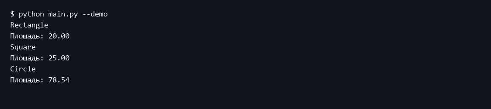
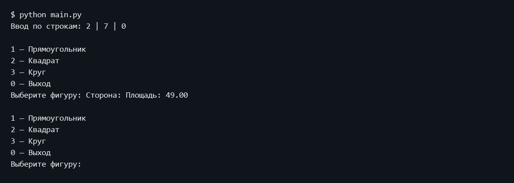
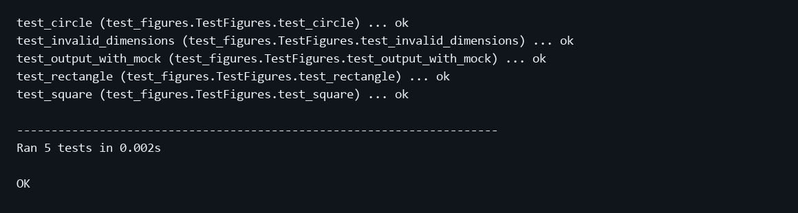

Министерство науки и высшего образования Российской Федерации
Московский государственный технический университет имени Н Э Баумана
Факультет Информатика и системы управления
Кафедра Системы обработки информации и управления

# Лабораторная работа 3
## Модульное тестирование в Python

Дисциплина: Парадигмы и конструкции языков программирования
Выполнил: студент группы ИУ5-32Б Трефилов Д.И.
Москва 2026

## 1 Цель работы
Изучить модульное и поведенческое тестирование, а также замену зависимостей Mock-объектами.

## 2 Постановка задачи
Выбрать фрагмент ЛР2, подготовить его к тестированию, написать не менее трех тестов в TDD-фреймворке и трех сценариев в BDD-фреймворке. Дополнительно применить Mock-объекты.

Источник задания: https://github.com/ugapanyuk/BKIT_2022/wiki/lab_python_test
Список курса: https://github.com/ugapanyuk/courses_content/wiki/COURSE_PCPL_MAIN

## 3 Структура и логика программы
Взят расчет площадей фигур из ЛР2. В самостоятельном пакете lab_python_test вычисления отделены от консоли. Размеры преобразуются в числа, нулевые, отрицательные и бесконечные значения отклоняются. print_area принимает зависимость output, что позволяет проверить вывод без обращения к терминалу. unittest используется как фреймворк модульного тестирования, behave выполняет русскоязычные сценарии Given When Then. Исходная ЛР2 остается самостоятельной. Обычный запуск main.py открывает ручной ввод: пользователь выбирает пункт меню, вводит свои данные и получает результат. После проверки можно ввести другой набор. Готовые примеры запускаются с --demo. В ЛР5 и ЛР6 подключение к Telegram запускается отдельно с --telegram; по умолчанию используется локальный диалог без токена.

## 4 Порядок запуска
Команды выполняются из папки работы в подготовленном окружении.
```powershell
python -m pip install -r requirements.txt
python main.py
python -m unittest discover -s tests -v
python -m behave
```

## 5 Проверка программы
Пять тестов unittest проверяют три площади, некорректные размеры и вызов Mock-функции вывода. Три BDD-сценария проверяют площади прямоугольника, квадрата и круга с точки зрения наблюдаемого результата.

### Пример выполнения
```text
$ python main.py --demo
Rectangle
Площадь: 20.00
Square
Площадь: 25.00
Circle
Площадь: 78.54
```

### Экранная форма выполнения


### Ручная проверка со своими значениями


### Модульные тесты
```text
test_circle (test_figures.TestFigures.test_circle) ... ok
test_invalid_dimensions (test_figures.TestFigures.test_invalid_dimensions) ... ok
test_output_with_mock (test_figures.TestFigures.test_output_with_mock) ... ok
test_rectangle (test_figures.TestFigures.test_rectangle) ... ok
test_square (test_figures.TestFigures.test_square) ... ok

----------------------------------------------------------------------
Ran 5 tests in 0.002s

OK
```



### BDD сценарии
```text
USING RUNNER: behave.runner:Runner
Функция: Вычисление площади геометрических фигур # features/figures.feature:2

  Сценарий: Площадь прямоугольника            # features/figures.feature:3
    Допустим прямоугольник со сторонами 5 и 4 # features/steps/figure_steps.py:6
    Когда вычислена площадь                   # features/steps/figure_steps.py:21
    Тогда площадь равна 20                    # features/steps/figure_steps.py:26

  Сценарий: Площадь квадрата       # features/figures.feature:8
    Допустим квадрат со стороной 5 # features/steps/figure_steps.py:11
    Когда вычислена площадь        # features/steps/figure_steps.py:21
    Тогда площадь равна 25         # features/steps/figure_steps.py:26

  Сценарий: Площадь круга                 # features/figures.feature:13
    Допустим круг с радиусом 5            # features/steps/figure_steps.py:16
    Когда вычислена площадь               # features/steps/figure_steps.py:21
    Тогда площадь равна 78.53981633974483 # features/steps/figure_steps.py:26

1 feature passed, 0 failed, 0 skipped
3 scenarios passed, 0 failed, 0 skipped
9 steps passed, 0 failed, 0 skipped
Took 0min 0.006s
```

## 6 Выводы
Тесты подтверждают вычисления, обработку неверных размеров и консольное представление результата. BDD-сценарии описывают поведение на языке предметной области.

## Приложение Листинги программ

### lab_python_test/figures.py
```python
"""Площади фигур из ЛР2 без зависимости от консольного интерфейса."""
import math
from dataclasses import dataclass


def positive(value):
    """Размер фигуры должен быть конечным положительным числом."""
    value = float(value)
    if not math.isfinite(value) or value <= 0:
        raise ValueError("Размер должен быть конечным положительным числом")
    return value


@dataclass
class Rectangle:
    width: float
    height: float
    color: str = "синий"

    def __post_init__(self):
        self.width = positive(self.width)
        self.height = positive(self.height)

    def square(self):
        return self.width * self.height


class Square(Rectangle):
    def __init__(self, side, color="красный"):
        super().__init__(side, side, color)


@dataclass
class Circle:
    radius: float
    color: str = "зеленый"

    def __post_init__(self):
        self.radius = positive(self.radius)

    def square(self):
        return math.pi * self.radius ** 2


def print_area(figure, output=print):
    """Внедрение зависимости позволяет заменить вывод Mock-объектом."""
    output(f"Площадь: {figure.square():.2f}")
```

### main.py
```python
import math
import sys
from lab_python_test.figures import Rectangle, Square, Circle, print_area


def demo():
    for figure in (Rectangle(5, 4), Square(5), Circle(5)):
        print(type(figure).__name__)
        print_area(figure)


def main():
    while True:
        print("\n1 — Прямоугольник\n2 — Квадрат\n3 — Круг\n0 — Выход")
        choice = input("Выберите фигуру: ").strip()
        if choice == "0":
            return
        try:
            if choice == "1":
                width = input("Ширина: ").replace(",", ".")
                height = input("Высота: ").replace(",", ".")
                figure = Rectangle(width, height)
            elif choice == "2":
                figure = Square(input("Сторона: ").replace(",", "."))
            elif choice == "3":
                figure = Circle(input("Радиус: ").replace(",", "."))
            else:
                print("Введите номер от 0 до 3.")
                continue
            if not math.isfinite(figure.square()) or figure.square() <= 0:
                raise ValueError("Размеры вне поддерживаемого диапазона")
            print_area(figure)
        except (ValueError, OverflowError) as exc:
            print(f"Ошибка: {exc}. Попробуйте снова.")


if __name__ == "__main__":
    try:
        demo() if "--demo" in sys.argv else main()
    except (EOFError, KeyboardInterrupt):
        print("\nПрограмма завершена.")
```

### requirements.txt
```text
behave==1.3.3
```

### features/figures.feature
```text
# language: ru
Функция: Вычисление площади геометрических фигур
  Сценарий: Площадь прямоугольника
    Допустим прямоугольник со сторонами 5 и 4
    Когда вычислена площадь
    Тогда площадь равна 20

  Сценарий: Площадь квадрата
    Допустим квадрат со стороной 5
    Когда вычислена площадь
    Тогда площадь равна 25

  Сценарий: Площадь круга
    Допустим круг с радиусом 5
    Когда вычислена площадь
    Тогда площадь равна 78.53981633974483
```

### features/steps/figure_steps.py
```python
import math
from behave import given, when, then
from lab_python_test.figures import Rectangle, Square, Circle


@given("прямоугольник со сторонами {width:g} и {height:g}")
def rectangle(context, width, height):
    context.figure = Rectangle(width, height)


@given("квадрат со стороной {side:g}")
def square(context, side):
    context.figure = Square(side)


@given("круг с радиусом {radius:g}")
def circle(context, radius):
    context.figure = Circle(radius)


@when("вычислена площадь")
def calculate(context):
    context.area = context.figure.square()


@then("площадь равна {expected:g}")
def check(context, expected):
    assert math.isclose(context.area, expected, rel_tol=1e-12)
```

### tests/test_figures.py
```python
import math
import unittest
from unittest.mock import Mock
from lab_python_test.figures import Rectangle, Square, Circle, print_area


class TestFigures(unittest.TestCase):
    def test_rectangle(self):
        self.assertEqual(Rectangle(5, 4).square(), 20)

    def test_square(self):
        self.assertEqual(Square(5).square(), 25)

    def test_circle(self):
        self.assertAlmostEqual(Circle(5).square(), math.pi * 25)

    def test_invalid_dimensions(self):
        for value in (0, -1, float("nan"), float("inf"), "abc"):
            for constructor in (Circle, Square, lambda x: Rectangle(2, x)):
                with self.subTest(value=value, constructor=constructor):
                    with self.assertRaises(ValueError):
                        constructor(value)

    def test_output_with_mock(self):
        output = Mock()
        print_area(Rectangle(5, 4), output)
        output.assert_called_once_with("Площадь: 20.00")


if __name__ == "__main__":
    unittest.main()
```
