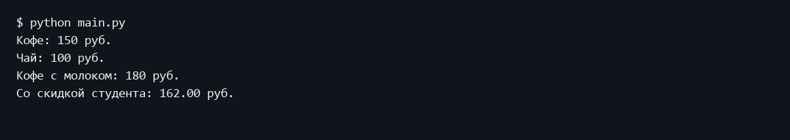
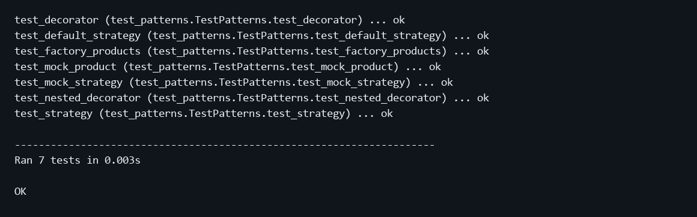

Министерство науки и высшего образования Российской Федерации
Московский государственный технический университет имени Н Э Баумана
Факультет Информатика и системы управления
Кафедра Системы обработки информации и управления

# Лабораторная работа 4
## Шаблоны проектирования и модульное тестирование в Python

Дисциплина: Парадигмы и конструкции языков программирования
Выполнил: студент группы ИУ5-32Б Трефилов Д.И.
Москва 2026

## 1 Цель работы
Изучить порождающие, структурные и поведенческие шаблоны и проверить их совместную работу.

## 2 Постановка задачи
Для одной предметной области реализовать три шаблона: один порождающий, один структурный и один поведенческий. Проверить код с помощью TDD-фреймворка, BDD-фреймворка и Mock-объектов.

Источник задания: https://github.com/ugapanyuk/BKIT_2021/wiki/lab_python_test
Список курса: https://github.com/ugapanyuk/courses_content/wiki/COURSE_PCPL_MAIN

## 3 Структура и логика программы
Предметная область - заказ напитка в кафе. Порождающий Фабричный метод: Cafe определяет create_product и использующий его order_price; CoffeeCafe и TeaCafe создают конкретные продукты. Структурный Декоратор: Milk оборачивает Product, сохраняет интерфейс price и добавляет 30 рублей. Поведенческая Стратегия: Order делегирует расчет RegularPrice или StudentDiscount. Денежные значения хранятся в Decimal; студенческая скидка равна 10 процентам.

## 4 Порядок запуска
Команды выполняются из папки работы в подготовленном окружении.
```powershell
python -m pip install -r requirements.txt
python main.py
python -m unittest discover -s tests -v
python -m behave
```

## 5 Проверка программы
Семь тестов unittest проверяют фабрики, цену чая, декоратор и его вложение, обычную цену и скидку. Mock-объекты подменяют стратегию и продукт, проверяя аргументы и число вызовов. Три сценария behave проверяют кофе за 150 рублей, кофе с молоком за 180 рублей и заказ со скидкой за 162 рубля.

### Пример выполнения
```text
$ python main.py
Кофе: 150 руб.
Чай: 100 руб.
Кофе с молоком: 180 руб.
Со скидкой студента: 162.00 руб.
```

### Экранная форма выполнения


### Модульные тесты
```text
test_decorator (test_patterns.TestPatterns.test_decorator) ... ok
test_default_strategy (test_patterns.TestPatterns.test_default_strategy) ... ok
test_factory_products (test_patterns.TestPatterns.test_factory_products) ... ok
test_mock_product (test_patterns.TestPatterns.test_mock_product) ... ok
test_mock_strategy (test_patterns.TestPatterns.test_mock_strategy) ... ok
test_nested_decorator (test_patterns.TestPatterns.test_nested_decorator) ... ok
test_strategy (test_patterns.TestPatterns.test_strategy) ... ok

----------------------------------------------------------------------
Ran 7 tests in 0.003s

OK
```



### BDD сценарии
```text
USING RUNNER: behave.runner:Runner
Функция: Расчет стоимости заказа в кафе # features/orders.feature:2

  Сценарий: Фабричный метод создает кофе  # features/orders.feature:3
    Допустим кафе создало кофе            # features/steps/order_steps.py:6
    Когда рассчитана стоимость заказа     # features/steps/order_steps.py:22
    Тогда к оплате 150 рублей             # features/steps/order_steps.py:27

  Сценарий: Декоратор добавляет молоко  # features/orders.feature:8
    Допустим кафе создало кофе          # features/steps/order_steps.py:6
    И к напитку добавлено молоко        # features/steps/order_steps.py:12
    Когда рассчитана стоимость заказа   # features/steps/order_steps.py:22
    Тогда к оплате 180 рублей           # features/steps/order_steps.py:27

  Сценарий: Стратегия применяет скидку студента  # features/orders.feature:14
    Допустим кафе создало кофе                   # features/steps/order_steps.py:6
    И к напитку добавлено молоко                 # features/steps/order_steps.py:12
    И выбрана скидка студента                    # features/steps/order_steps.py:17
    Когда рассчитана стоимость заказа            # features/steps/order_steps.py:22
    Тогда к оплате 162 рублей                    # features/steps/order_steps.py:27

1 feature passed, 0 failed, 0 skipped
3 scenarios passed, 0 failed, 0 skipped
12 steps passed, 0 failed, 0 skipped
Took 0min 0.002s
```

## 6 Выводы
Все три категории шаблонов представлены в единой модели заказа. Модульные проверки и BDD-сценарии подтверждают расчет стоимости и взаимодействие зависимостей.

## Приложение Листинги программ

### lab_python_patterns/orders.py
```python
"""Фабричный метод, Декоратор и Стратегия в одной предметной области."""
from abc import ABC, abstractmethod
from decimal import Decimal


class Product(ABC):
    @abstractmethod
    def price(self):
        """Стоимость позиции."""


class Coffee(Product):
    def price(self):
        return Decimal("150")


class Tea(Product):
    def price(self):
        return Decimal("100")


class Cafe(ABC):
    """Создатель: подклассы переопределяют фабричный метод."""
    @abstractmethod
    def create_product(self):
        """Создать продукт."""

    def order_price(self):
        return self.create_product().price()


class CoffeeCafe(Cafe):
    def create_product(self):
        return Coffee()


class TeaCafe(Cafe):
    def create_product(self):
        return Tea()


class Milk(Product):
    """Структурный Декоратор сохраняет интерфейс оборачиваемого объекта."""
    def __init__(self, product):
        self.product = product

    def price(self):
        return self.product.price() + Decimal("30")


class PricingStrategy(ABC):
    @abstractmethod
    def apply(self, amount):
        """Применить правило расчета."""


class RegularPrice(PricingStrategy):
    def apply(self, amount):
        return amount


class StudentDiscount(PricingStrategy):
    def apply(self, amount):
        return (amount * Decimal("0.90")).quantize(Decimal("0.01"))


class Order:
    def __init__(self, product, strategy=None):
        self.product = product
        self.strategy = strategy if strategy is not None else RegularPrice()

    def total(self):
        return self.strategy.apply(self.product.price())
```

### main.py
```python
from lab_python_patterns.orders import CoffeeCafe, TeaCafe, Milk, Order, StudentDiscount


def main():
    print(f"Кофе: {CoffeeCafe().order_price()} руб.")
    print(f"Чай: {TeaCafe().order_price()} руб.")
    coffee = Milk(CoffeeCafe().create_product())
    print(f"Кофе с молоком: {coffee.price()} руб.")
    print(f"Со скидкой студента: {Order(coffee, StudentDiscount()).total()} руб.")


if __name__ == "__main__":
    main()
```

### requirements.txt
```text
behave==1.3.3
```

### features/orders.feature
```text
# language: ru
Функция: Расчет стоимости заказа в кафе
  Сценарий: Фабричный метод создает кофе
    Допустим кафе создало кофе
    Когда рассчитана стоимость заказа
    Тогда к оплате 150 рублей

  Сценарий: Декоратор добавляет молоко
    Допустим кафе создало кофе
    И к напитку добавлено молоко
    Когда рассчитана стоимость заказа
    Тогда к оплате 180 рублей

  Сценарий: Стратегия применяет скидку студента
    Допустим кафе создало кофе
    И к напитку добавлено молоко
    И выбрана скидка студента
    Когда рассчитана стоимость заказа
    Тогда к оплате 162 рублей
```

### features/steps/order_steps.py
```python
from decimal import Decimal
from behave import given, when, then
from lab_python_patterns.orders import CoffeeCafe, Milk, Order, StudentDiscount


@given("кафе создало кофе")
def coffee(context):
    context.product = CoffeeCafe().create_product()
    context.strategy = None


@given("к напитку добавлено молоко")
def milk(context):
    context.product = Milk(context.product)


@given("выбрана скидка студента")
def discount(context):
    context.strategy = StudentDiscount()


@when("рассчитана стоимость заказа")
def calculate(context):
    context.total = Order(context.product, context.strategy).total()


@then("к оплате {amount} рублей")
def check(context, amount):
    assert context.total == Decimal(amount)
```

### tests/test_patterns.py
```python
import unittest
from decimal import Decimal
from unittest.mock import Mock
from lab_python_patterns.orders import (
    Coffee, Tea, CoffeeCafe, TeaCafe, Milk, Order, StudentDiscount,
)


class TestPatterns(unittest.TestCase):
    def test_factory_products(self):
        self.assertIsInstance(CoffeeCafe().create_product(), Coffee)
        self.assertIsInstance(TeaCafe().create_product(), Tea)
        self.assertEqual(TeaCafe().order_price(), Decimal("100"))

    def test_decorator(self):
        coffee = Coffee()
        self.assertEqual(Milk(coffee).price(), Decimal("180"))
        self.assertEqual(coffee.price(), Decimal("150"))

    def test_nested_decorator(self):
        self.assertEqual(Milk(Milk(Coffee())).price(), Decimal("210"))

    def test_strategy(self):
        order = Order(Milk(Coffee()), StudentDiscount())
        self.assertEqual(order.total(), Decimal("162.00"))

    def test_default_strategy(self):
        self.assertEqual(Order(Coffee()).total(), Decimal("150"))

    def test_mock_strategy(self):
        strategy = Mock()
        strategy.apply.return_value = Decimal("1")
        self.assertEqual(Order(Coffee(), strategy).total(), Decimal("1"))
        strategy.apply.assert_called_once_with(Decimal("150"))

    def test_mock_product(self):
        product = Mock(spec=Coffee)
        product.price.return_value = Decimal("200")
        self.assertEqual(Milk(product).price(), Decimal("230"))
        product.price.assert_called_once_with()


if __name__ == "__main__":
    unittest.main()
```
