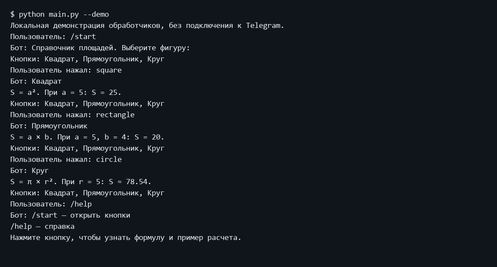
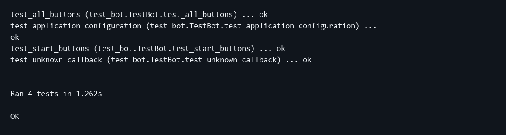

Министерство науки и высшего образования Российской Федерации
Московский государственный технический университет имени Н Э Баумана
Факультет Информатика и системы управления
Кафедра Системы обработки информации и управления

# Лабораторная работа 5
## Разработка простого бота для Telegram

Дисциплина: Парадигмы и конструкции языков программирования
Выполнил: студент группы ИУ5-32Б Трефилов Д.И.
Москва 2026

## 1 Цель работы
Освоить команды Telegram-бота, inline-кнопки и обработку callback-запросов.

## 2 Постановка задачи
Разработать простого Telegram-бота с функциональностью создания кнопок. Предметная область - справочник площадей геометрических фигур.

Источник задания: https://github.com/ugapanyuk/BKIT_2021/wiki/lab_bot1
Список курса: https://github.com/ugapanyuk/courses_content/wiki/COURSE_PCPL_MAIN

## 3 Структура и логика программы
Команда /start выводит InlineKeyboardMarkup с кнопками Квадрат, Прямоугольник и Круг. Нажатие отправляет callback_data. choose_figure подтверждает callback вызовом answer и редактирует сообщение, показывая формулу и пример. Клавиатура сохраняется для повторного выбора. /help выводит инструкцию. Токен читается из TELEGRAM_BOT_TOKEN; при его отсутствии программа завершает запуск с понятным сообщением.

## 4 Порядок запуска
Команды выполняются из папки работы в подготовленном окружении.
```powershell
python -m pip install -r requirements.txt
python main.py --demo
python -m unittest discover -s tests -v
```

Запуск с подключением к Telegram в PowerShell:
```powershell
$env:TELEGRAM_BOT_TOKEN = 'ваш_токен'
python main.py
```
Файл .env автоматически не загружается. Токен в отчет и Git не добавляется.

## 5 Проверка программы
Четыре асинхронных теста проверяют кнопки /start, все три формулы, неизвестный callback и регистрацию обработчиков. AsyncMock подменяет ответы Telegram API. main.py --demo вызывает настоящие обработчики с локальным выводом. Доступ к Telegram API и реальный диалог в Telegram не проверялись: токен пользователя не предоставлен. Экранная форма ниже показывает локальную демонстрацию, а не интерфейс Telegram.

### Пример выполнения
```text
$ python main.py --demo
Локальная демонстрация обработчиков, без подключения к Telegram.
Пользователь: /start
Бот: Справочник площадей. Выберите фигуру:
Кнопки: Квадрат, Прямоугольник, Круг
Пользователь нажал: square
Бот: Квадрат
S = a². При a = 5: S = 25.
Кнопки: Квадрат, Прямоугольник, Круг
Пользователь нажал: rectangle
Бот: Прямоугольник
S = a × b. При a = 5, b = 4: S = 20.
Кнопки: Квадрат, Прямоугольник, Круг
Пользователь нажал: circle
Бот: Круг
S = π × r². При r = 5: S ≈ 78.54.
Кнопки: Квадрат, Прямоугольник, Круг
Пользователь: /help
Бот: /start — открыть кнопки
/help — справка
Нажмите кнопку, чтобы узнать формулу и пример расчета.
```

### Экранная форма выполнения


### Модульные тесты
```text
test_all_buttons (test_bot.TestBot.test_all_buttons) ... ok
test_application_configuration (test_bot.TestBot.test_application_configuration) ...
ok
test_start_buttons (test_bot.TestBot.test_start_buttons) ... ok
test_unknown_callback (test_bot.TestBot.test_unknown_callback) ... ok

----------------------------------------------------------------------
Ran 4 tests in 1.262s

OK
```



## 6 Выводы
Бот реализует команды и inline-кнопки; локальные тесты подтверждают ответы обработчиков. Для проверки в Telegram необходимо задать личный токен и запустить polling.

## Приложение Листинги программ

### demo.py
```python
"""Локальный вызов настоящих обработчиков без Telegram API и токена."""
import asyncio
from types import SimpleNamespace
from lab_telegram_bot.bot import start, choose_figure, help_command


async def display(text, **kwargs):
    print("Бот:", text)
    markup = kwargs.get("reply_markup")
    if markup:
        print("Кнопки:", ", ".join(b.text for row in markup.inline_keyboard for b in row))


async def answer():
    pass


async def demo():
    print("Локальная демонстрация обработчиков, без подключения к Telegram.")
    message = SimpleNamespace(reply_text=display)
    query = SimpleNamespace(data="square", answer=answer, edit_message_text=display)
    update = SimpleNamespace(effective_message=message, callback_query=query)
    print("Пользователь: /start")
    await start(update, None)
    for key in ("square", "rectangle", "circle"):
        print("Пользователь нажал:", key)
        query.data = key
        await choose_figure(update, None)
    print("Пользователь: /help")
    await help_command(update, None)


def run():
    asyncio.run(demo())


if __name__ == "__main__":
    run()
```

### lab_telegram_bot/bot.py
```python
"""Справочник геометрических фигур с inline-клавиатурой."""
import os
from telegram import InlineKeyboardButton, InlineKeyboardMarkup
from telegram.ext import Application, CommandHandler, CallbackQueryHandler

FIGURES = {
    "square": ("Квадрат", "S = a². При a = 5: S = 25."),
    "rectangle": ("Прямоугольник", "S = a × b. При a = 5, b = 4: S = 20."),
    "circle": ("Круг", "S = π × r². При r = 5: S ≈ 78.54."),
}


def keyboard():
    return InlineKeyboardMarkup([
        [InlineKeyboardButton(title, callback_data=key)]
        for key, (title, _) in FIGURES.items()
    ])


async def start(update, context):
    await update.effective_message.reply_text(
        "Справочник площадей. Выберите фигуру:", reply_markup=keyboard()
    )


async def help_command(update, context):
    await update.effective_message.reply_text(
        "/start — открыть кнопки\n/help — справка\n"
        "Нажмите кнопку, чтобы узнать формулу и пример расчета."
    )


async def choose_figure(update, context):
    query = update.callback_query
    await query.answer()
    figure = FIGURES.get(query.data)
    text = "Неизвестная фигура. Выберите кнопку ниже."
    if figure is not None:
        text = f"{figure[0]}\n{figure[1]}"
    await query.edit_message_text(text, reply_markup=keyboard())


def build_application(token):
    app = Application.builder().token(token).build()
    app.add_handler(CommandHandler("start", start))
    app.add_handler(CommandHandler("help", help_command))
    app.add_handler(CallbackQueryHandler(choose_figure))
    return app


def main():
    token = os.environ.get("TELEGRAM_BOT_TOKEN")
    if not token:
        raise SystemExit("Задайте переменную окружения TELEGRAM_BOT_TOKEN из BotFather.")
    build_application(token).run_polling()
```

### main.py
```python
import sys
from lab_telegram_bot.bot import main


if __name__ == "__main__":
    if "--demo" in sys.argv:
        from demo import run
        run()
    else:
        main()
```

### requirements.txt
```text
python-telegram-bot==22.8
```

### tests/test_bot.py
```python
import unittest
from types import SimpleNamespace
from unittest.mock import AsyncMock
from lab_telegram_bot.bot import start, choose_figure, keyboard, build_application


class TestBot(unittest.IsolatedAsyncioTestCase):
    async def test_start_buttons(self):
        message = SimpleNamespace(reply_text=AsyncMock())
        await start(SimpleNamespace(effective_message=message), None)
        markup = message.reply_text.call_args.kwargs["reply_markup"]
        self.assertEqual(len(markup.inline_keyboard), 3)

    async def test_all_buttons(self):
        for key, expected in (("square", "25"), ("rectangle", "20"), ("circle", "78.54")):
            with self.subTest(key=key):
                query = SimpleNamespace(data=key, answer=AsyncMock(), edit_message_text=AsyncMock())
                await choose_figure(SimpleNamespace(callback_query=query), None)
                query.answer.assert_awaited_once()
                self.assertIn(expected, query.edit_message_text.call_args.args[0])

    async def test_unknown_callback(self):
        query = SimpleNamespace(data="bad", answer=AsyncMock(), edit_message_text=AsyncMock())
        await choose_figure(SimpleNamespace(callback_query=query), None)
        self.assertIn("Неизвестная", query.edit_message_text.call_args.args[0])

    async def test_application_configuration(self):
        app = build_application("123456:LOCAL_TEST_TOKEN")
        self.assertEqual(len(app.handlers[0]), 3)
        self.assertEqual([row[0].callback_data for row in keyboard().inline_keyboard],
                         ["square", "rectangle", "circle"])


if __name__ == "__main__":
    unittest.main()
```
