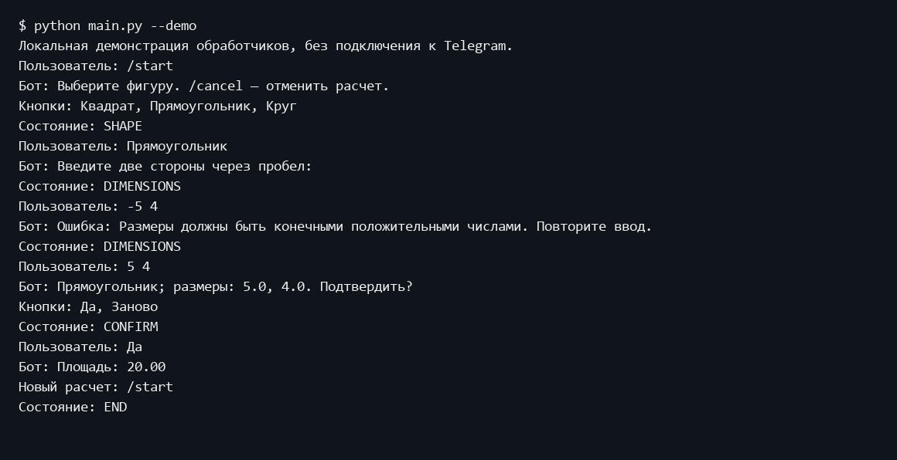
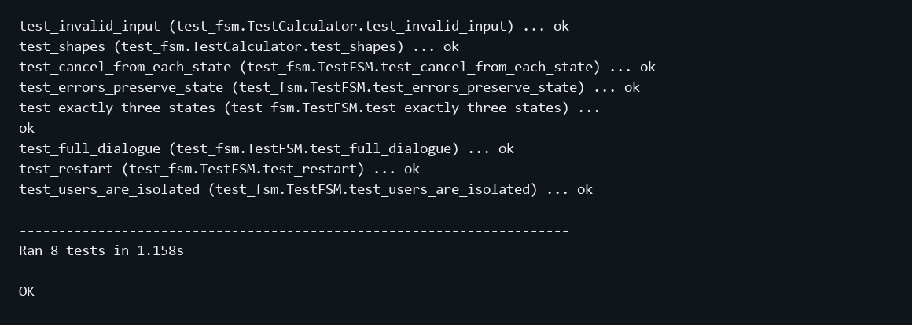

Министерство науки и высшего образования Российской Федерации
Московский государственный технический университет имени Н Э Баумана
Факультет Информатика и системы управления
Кафедра Системы обработки информации и управления

# Лабораторная работа 6
## Разработка Telegram бота на основе конечного автомата

Дисциплина: Парадигмы и конструкции языков программирования
Выполнил: студент группы ИУ5-32Б Трефилов Д.И.
Москва 2026

## 1 Цель работы
Реализовать диалог Telegram-бота как конечный автомат из трех состояний.

## 2 Постановка задачи
Разработать бота для вычисления площади. Организовать выбор фигуры, ввод размеров и подтверждение как три состояния диалога.

Источник задания: https://github.com/ugapanyuk/BKIT_2021/wiki/lab_bot2
Список курса: https://github.com/ugapanyuk/courses_content/wiki/COURSE_PCPL_MAIN

## 3 Структура и логика программы
ConversationHandler содержит ровно три состояния: SHAPE = 0, DIMENSIONS = 1 и CONFIRM = 2. /start открывает SHAPE. Корректный выбор фигуры переводит в DIMENSIONS. Корректные размеры переводят в CONFIRM. Да выводит площадь и завершает разговор через END; Заново возвращает в SHAPE. Ошибки сохраняют текущее состояние. /cancel завершает разговор на любой стадии, /start позволяет начать заново. END - служебный маркер завершения библиотеки, а не четвертое состояние states. Бот работает в личных сообщениях; concurrent_updates(False) обеспечивает последовательную обработку. Данные отдельного пользователя находятся в context.user_data и очищаются при завершении. Размеры принимаются с десятичной точкой или запятой, для прямоугольника - через пробел.

## 4 Порядок запуска
Команды выполняются из папки работы в подготовленном окружении.
```powershell
python -m pip install -r requirements.txt
python main.py --demo
python -m unittest discover -s tests -v
```

Запуск с подключением к Telegram в PowerShell:
```powershell
$env:TELEGRAM_BOT_TOKEN = 'ваш_токен'
python main.py
```
Файл .env автоматически не загружается. Токен в отчет и Git не добавляется.

## 5 Проверка программы
Восемь тестов проверяют расчет трех фигур, неверные значения, полный диалог, сохранение состояния при ошибке, повторный расчет, отмену, разделение контекстов пользователей и ровно три состояния в ConversationHandler. Асинхронные ответы подменены AsyncMock. main.py --demo проходит реальный код обработчиков, включая ошибочный ввод. Доступ к Telegram API и реальный диалог в Telegram не проверялись без личного токена. После перезапуска процесса незавершенные диалоги сбрасываются.

### Пример выполнения
```text
$ python main.py --demo
Локальная демонстрация обработчиков, без подключения к Telegram.
Пользователь: /start
Бот: Выберите фигуру. /cancel — отменить расчет.
Кнопки: Квадрат, Прямоугольник, Круг
Состояние: SHAPE
Пользователь: Прямоугольник
Бот: Введите две стороны через пробел:
Состояние: DIMENSIONS
Пользователь: -5 4
Бот: Ошибка: Размеры должны быть конечными положительными числами. Повторите ввод.
Состояние: DIMENSIONS
Пользователь: 5 4
Бот: Прямоугольник; размеры: 5.0, 4.0. Подтвердить?
Кнопки: Да, Заново
Состояние: CONFIRM
Пользователь: Да
Бот: Площадь: 20.00
Новый расчет: /start
Состояние: END
```

### Экранная форма выполнения


### Модульные тесты
```text
test_invalid_input (test_fsm.TestCalculator.test_invalid_input) ... ok
test_shapes (test_fsm.TestCalculator.test_shapes) ... ok
test_cancel_from_each_state (test_fsm.TestFSM.test_cancel_from_each_state) ... ok
test_errors_preserve_state (test_fsm.TestFSM.test_errors_preserve_state) ... ok
test_exactly_three_states (test_fsm.TestFSM.test_exactly_three_states) ...
ok
test_full_dialogue (test_fsm.TestFSM.test_full_dialogue) ... ok
test_restart (test_fsm.TestFSM.test_restart) ... ok
test_users_are_isolated (test_fsm.TestFSM.test_users_are_isolated) ... ok

----------------------------------------------------------------------
Ran 8 tests in 1.158s

OK
```



## 6 Выводы
Реализован автомат с тремя состояниями, проверкой ввода, повторным расчетом и отменой. Локальный диалог и тесты подтверждают переходы обработчиков; для проверки в Telegram требуется токен BotFather.

## Приложение Листинги программ

### demo.py
```python
"""Проверяемый локальный диалог через настоящие обработчики."""
import asyncio
from types import SimpleNamespace
from lab_telegram_fsm.bot import start, choose_shape, enter_dimensions, confirm


async def display(text, **kwargs):
    print("Бот:", text)
    markup = kwargs.get("reply_markup")
    if hasattr(markup, "keyboard"):
        print("Кнопки:", ", ".join(b.text for row in markup.keyboard for b in row))


async def demo():
    print("Локальная демонстрация обработчиков, без подключения к Telegram.")
    context = SimpleNamespace(user_data={})
    message = SimpleNamespace(text="", reply_text=display)
    update = SimpleNamespace(effective_message=message)
    for text, handler in (("/start", start), ("Прямоугольник", choose_shape),
                          ("-5 4", enter_dimensions), ("5 4", enter_dimensions),
                          ("Да", confirm)):
        message.text = text
        print("Пользователь:", text)
        state = await handler(update, context)
        print("Состояние:", {0: "SHAPE", 1: "DIMENSIONS", 2: "CONFIRM", -1: "END"}[state])


def run():
    asyncio.run(demo())


if __name__ == "__main__":
    run()
```

### lab_telegram_fsm/bot.py
```python
import os
from telegram import ReplyKeyboardMarkup, ReplyKeyboardRemove
from telegram.ext import (
    Application, CommandHandler, MessageHandler, ConversationHandler, filters,
)
from .calculator import SHAPES, calculate

SHAPE, DIMENSIONS, CONFIRM = range(3)


def shape_keyboard():
    return ReplyKeyboardMarkup([[name] for name in SHAPES], resize_keyboard=True,
                               one_time_keyboard=True)


async def start(update, context):
    context.user_data.clear()
    await update.effective_message.reply_text(
        "Выберите фигуру. /cancel — отменить расчет.", reply_markup=shape_keyboard()
    )
    return SHAPE


async def choose_shape(update, context):
    shape = update.effective_message.text.strip()
    if shape not in SHAPES:
        await update.effective_message.reply_text("Выберите фигуру кнопкой.")
        return SHAPE
    context.user_data["shape"] = shape
    prompt = "Введите две стороны через пробел:" if shape == "Прямоугольник" else (
        "Введите радиус:" if shape == "Круг" else "Введите сторону:")
    await update.effective_message.reply_text(prompt, reply_markup=ReplyKeyboardRemove())
    return DIMENSIONS


async def enter_dimensions(update, context):
    shape = context.user_data["shape"]
    try:
        values, area = calculate(shape, update.effective_message.text)
    except ValueError as exc:
        await update.effective_message.reply_text(f"Ошибка: {exc}. Повторите ввод.")
        return DIMENSIONS
    context.user_data.update(values=values, area=area)
    await update.effective_message.reply_text(
        f"{shape}; размеры: {', '.join(map(str, values))}. Подтвердить?",
        reply_markup=ReplyKeyboardMarkup([["Да", "Заново"]], resize_keyboard=True),
    )
    return CONFIRM


async def confirm(update, context):
    text = update.effective_message.text.strip().casefold()
    if text == "заново":
        return await start(update, context)
    if text != "да":
        await update.effective_message.reply_text("Нажмите Да или Заново.")
        return CONFIRM
    await update.effective_message.reply_text(
        f"Площадь: {context.user_data['area']:.2f}\nНовый расчет: /start",
        reply_markup=ReplyKeyboardRemove(),
    )
    context.user_data.clear()
    return ConversationHandler.END


async def cancel(update, context):
    context.user_data.clear()
    await update.effective_message.reply_text(
        "Расчет отменен. Новый расчет: /start", reply_markup=ReplyKeyboardRemove()
    )
    return ConversationHandler.END


def build_application(token):
    # ConversationHandler требует последовательной обработки обновлений.
    app = Application.builder().token(token).concurrent_updates(False).build()
    private_text = filters.ChatType.PRIVATE & filters.TEXT & ~filters.COMMAND
    conversation = ConversationHandler(
        entry_points=[CommandHandler("start", start, filters=filters.ChatType.PRIVATE)],
        states={
            SHAPE: [MessageHandler(private_text, choose_shape)],
            DIMENSIONS: [MessageHandler(private_text, enter_dimensions)],
            CONFIRM: [MessageHandler(private_text, confirm)],
        },
        fallbacks=[CommandHandler("cancel", cancel)],
        allow_reentry=True,
    )
    app.add_handler(conversation)
    return app


def main():
    token = os.environ.get("TELEGRAM_BOT_TOKEN")
    if not token:
        raise SystemExit("Задайте переменную окружения TELEGRAM_BOT_TOKEN из BotFather.")
    build_application(token).run_polling()
```

### lab_telegram_fsm/calculator.py
```python
import math

SHAPES = {"Квадрат": 1, "Прямоугольник": 2, "Круг": 1}


def calculate(shape, text):
    """Разбор размеров и вычисление площади без зависимости от Telegram."""
    if shape not in SHAPES:
        raise ValueError("Неизвестная фигура")
    try:
        values = [float(part.replace(",", ".")) for part in text.split()]
    except ValueError as exc:
        raise ValueError("Введите числа через пробел") from exc
    if len(values) != SHAPES[shape]:
        raise ValueError(f"Количество размеров: {SHAPES[shape]}")
    if any(not math.isfinite(x) or x <= 0 for x in values):
        raise ValueError("Размеры должны быть конечными положительными числами")
    try:
        if shape == "Квадрат":
            area = values[0] ** 2
        elif shape == "Круг":
            area = math.pi * values[0] ** 2
        else:
            area = values[0] * values[1]
    except OverflowError as exc:
        raise ValueError("Размеры слишком велики") from exc
    if not math.isfinite(area) or area <= 0:
        raise ValueError("Размеры вне поддерживаемого диапазона")
    return values, area
```

### main.py
```python
import sys
from lab_telegram_fsm.bot import main


if __name__ == "__main__":
    if "--demo" in sys.argv:
        from demo import run
        run()
    else:
        main()
```

### requirements.txt
```text
python-telegram-bot==22.8
```

### tests/test_fsm.py
```python
import math
import unittest
from types import SimpleNamespace
from unittest.mock import AsyncMock
from telegram.ext import ConversationHandler
from lab_telegram_fsm.calculator import calculate
from lab_telegram_fsm.bot import (
    SHAPE, DIMENSIONS, CONFIRM, start, choose_shape, enter_dimensions,
    confirm, cancel, build_application,
)


class TestCalculator(unittest.TestCase):
    def test_shapes(self):
        self.assertEqual(calculate("Квадрат", "5")[1], 25)
        self.assertEqual(calculate("Прямоугольник", "5 4")[1], 20)
        self.assertAlmostEqual(calculate("Круг", "5")[1], math.pi * 25)
        self.assertEqual(calculate("Квадрат", "2,5")[1], 6.25)

    def test_invalid_input(self):
        for text in ("", "abc", "0", "-1", "nan", "inf", "5 4", "1e308", "1e-300"):
            with self.subTest(text=text), self.assertRaises(ValueError):
                calculate("Квадрат", text)


class TestFSM(unittest.IsolatedAsyncioTestCase):
    def setUp(self):
        self.message = SimpleNamespace(text="", reply_text=AsyncMock())
        self.update = SimpleNamespace(effective_message=self.message)
        self.context = SimpleNamespace(user_data={})

    async def call(self, handler, text):
        self.message.text = text
        return await handler(self.update, self.context)

    async def test_full_dialogue(self):
        self.assertEqual(await self.call(start, "/start"), SHAPE)
        self.assertEqual(await self.call(choose_shape, "Прямоугольник"), DIMENSIONS)
        self.assertEqual(await self.call(enter_dimensions, "5 4"), CONFIRM)
        self.assertEqual(await self.call(confirm, "Да"), ConversationHandler.END)
        self.assertIn("20.00", self.message.reply_text.call_args.args[0])
        self.assertEqual(self.context.user_data, {})

    async def test_errors_preserve_state(self):
        await self.call(start, "/start")
        self.assertEqual(await self.call(choose_shape, "Треугольник"), SHAPE)
        await self.call(choose_shape, "Круг")
        self.assertEqual(await self.call(enter_dimensions, "-5"), DIMENSIONS)
        await self.call(enter_dimensions, "5")
        self.assertEqual(await self.call(confirm, "нет"), CONFIRM)

    async def test_restart(self):
        await self.call(start, "/start")
        await self.call(choose_shape, "Квадрат")
        await self.call(enter_dimensions, "5")
        self.assertEqual(await self.call(confirm, "Заново"), SHAPE)
        self.assertEqual(self.context.user_data, {})

    async def test_cancel_from_each_state(self):
        for state in (SHAPE, DIMENSIONS, CONFIRM):
            self.context.user_data.update(shape="Круг", area=20)
            self.assertEqual(await self.call(cancel, "/cancel"), ConversationHandler.END)
            self.assertEqual(self.context.user_data, {})

    async def test_users_are_isolated(self):
        other = SimpleNamespace(user_data={"shape": "Круг"})
        await self.call(start, "/start")
        await self.call(choose_shape, "Квадрат")
        self.assertEqual(other.user_data, {"shape": "Круг"})
        self.assertEqual(self.context.user_data, {"shape": "Квадрат"})

    async def test_exactly_three_states(self):
        app = build_application("123456:LOCAL_TEST_TOKEN")
        self.assertEqual(set(app.handlers[0][0].states), {SHAPE, DIMENSIONS, CONFIRM})
        self.assertEqual(app.update_processor.max_concurrent_updates, 1)


if __name__ == "__main__":
    unittest.main()
```
